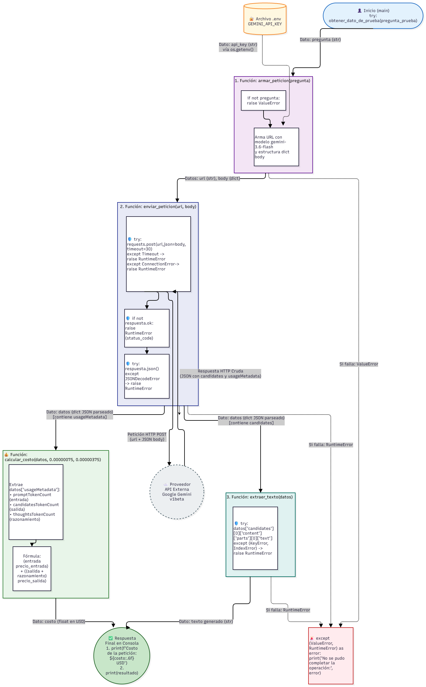

# Decisión de arquitectura: elección de modelo

**Fecha de la comparación:** 23 de octubre de 2026
**Miniaplicación:** Asistente de Documentación de Data Warehouse (dbt Docs Assistant)

## Modelo elegido

* **Modelo:** `gemini-3.6-flash`
* **Mi miniaplicación sirve para:** ayudar a equipos de datos y analistas de negocio a entender la documentación de un Data Warehouse (`schema.yml`, descripciones de modelos dbt y definiciones de KPIs), respondiendo dudas sobre tablas, columnas y linaje, y detectando objetos sin documentar.
* **Requisitos:**
  1. **Precisión técnica y formato estructurado:** interpretar YAML de dbt y devolver JSON estricto.
  2. **Latencia razonable y estabilidad:** responder de forma confiable, sin caídas constantes por saturación (`503`) ni tiempos de espera agotados.
  3. **Eficiencia en costo:** consumo moderado de tokens, incluidos los de razonamiento (`thoughtsTokenCount`).

## Diagrama de arquitectura

*(Archivo en el repositorio: `docs/diagrama_arquitectura.png`)*

## Comparación de candidatos

Se usaron 4 preguntas del dominio dbt / Data Warehouse. Los costos se calculan con la tarifa de pago estándar de referencia ($0.75 USD por millón de tokens de entrada y $3.75 USD por millón de tokens de salida) e incluyen los tokens de razonamiento. Son estimados, porque las pruebas se hicieron en capa gratuita.

* **P1:** "Explica en una sola frase breve por qué el archivo schema.yml de dbt es clave para documentar un Data Warehouse."
* **P2:** "Escribe un ejemplo básico de un archivo schema.yml en dbt que documente una tabla llamada 'fact_ventas' con dos columnas: 'id_venta' y 'monto_total'."
* **P3:** "Si un analista de negocio pregunta '¿De qué tabla sale la métrica de ingresos netos?', explica en tres pasos cómo buscarías esa respuesta dentro de las descripciones de modelos dbt."
* **P4:** "Explica qué es un 'linaje de datos' (data lineage) en dbt, usando un lenguaje muy sencillo y una analogía para un analista de negocio que no sabe programar."

| Criterio | `gemini-3.6-flash` (elegido) | `gemini-3.5-flash` | `gemini-3.8-flash` |
| :--- | :--- | :--- | :--- |
| Tarifa de entrada (USD / 1M tokens) | $0.75 | $0.75 | $0.75 |
| Tarifa de salida (USD / 1M tokens) | $3.75 | $3.75 | $3.75 |
| Preguntas respondidas | 4 de 4 | 3 de 4 (P4: `503`) | 0 de 4 |
| Latencias observadas (s) | P1 4.66, P2 6.02, P3 10.45, P4 12.67 | P1 5.13, P2 8.23, P3 9.81 | Sin datos: P1 `503`; P2, P3 y P4 tiempo de espera agotado (60 s) |
| Latencia promedio | **8.45 s** | 7.73 s | No medible |
| Costo promedio por petición | **$0.004398 USD** | $0.003843 USD | No medible |
| Calidad para la miniaplicación | Alta: respuestas correctas y completas en P1 a P4 | Igual que 3.6 (es el mismo motor, ver nota 1) | No evaluable: no respondió ninguna pregunta |

**Fuente de las tarifas:** Google AI for Developers (`https://ai.google.dev/pricing`), tarifa de pago estándar usada en el script. El script usa la misma tarifa para los tres modelos; queda pendiente confirmarla modelo por modelo en la página oficial.

**Evidencia:** `docs/respuestas_completas.md` (corrida del 2026-10-23 12:56).

**Notas sobre las pruebas:**
1. Al consultar `modelVersion`, las peticiones enviadas a `gemini-3.5-flash` fueron atendidas por **`gemini-3.6-flash`**. Por eso la diferencia entre sus promedios (7.73 s frente a 8.45 s) no compara dos modelos distintos: refleja la variación normal entre peticiones del mismo motor.
2. **`gemini-3.8-flash` falló en las 4 preguntas.** El script hace hasta 4 intentos por pregunta (con espera creciente entre ellos), es decir, unos 16 intentos en total y ninguno exitoso. P1 devolvió `503` ("alta demanda") en todos los intentos, y P2, P3 y P4 agotaron el tiempo de espera de 60 s. En esta corrida no hubo errores `429` (cuota). En la corrida anterior (22-oct), que no se conservó, también devolvió `503` en P1.
3. En la prueba manual del Bloque 4 (alias `gemini-flash-latest`) la API sí respondió con `gemini-3.8-flash` en 3.70 s. El modelo funciona, pero su disponibilidad es intermitente.
4. El alias `gemini-3.5-flash` también recibió un `503` en P4, así que la saturación del servicio puede afectar a cualquier modelo y conviene mantener los reintentos del código.
5. En la columna 3.5, la respuesta de P3 terminó cortada en el paso 3. La de 3.6 en esa misma pregunta salió completa.

## Justificación

Elegí `gemini-3.6-flash` porque fue el único candidato que respondió las 4 preguntas, con respuestas correctas y completas, una latencia promedio de 8.45 s y un costo promedio de $0.004398 USD por petición. El criterio que más pesó fue la **estabilidad operativa**: `gemini-3.8-flash` falló siempre en esta corrida (unos 16 intentos sin una sola respuesta) y también en la corrida anterior. Con esa muestra, lo más probable es que siga fallando, y una aplicación que no puede responder no cumple el requisito 2, por muy buena que sea su calidad en teoría. Limitaciones de esta decisión: la muestra es pequeña (una corrida de 4 preguntas), la saturación puede ser temporal, y la latencia (alrededor de 8.5 s) es mayor a la ideal para consultas interactivas. Si `gemini-3.8-flash` se estabiliza, la comparación debería repetirse.

## Alternativa descartada y por qué

* **`gemini-3.8-flash`:** descartado por **inestabilidad**. No respondió ninguna de las 4 preguntas (`503` por alta demanda y tiempos de espera agotados tras reintentos), así que no hay datos de latencia, costo ni calidad para evaluarlo.
* **`gemini-3.5-flash`:** descartado porque es un alias que la API enruta a `gemini-3.6-flash`. Usar directamente 3.6 evita depender de un alias y deja claro qué modelo ejecuta la arquitectura.